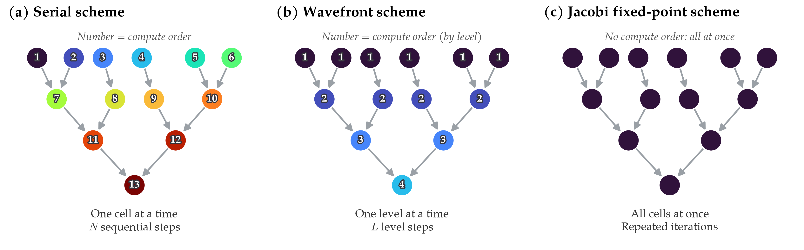
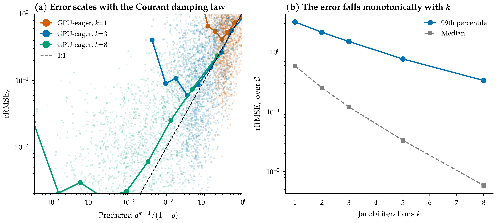
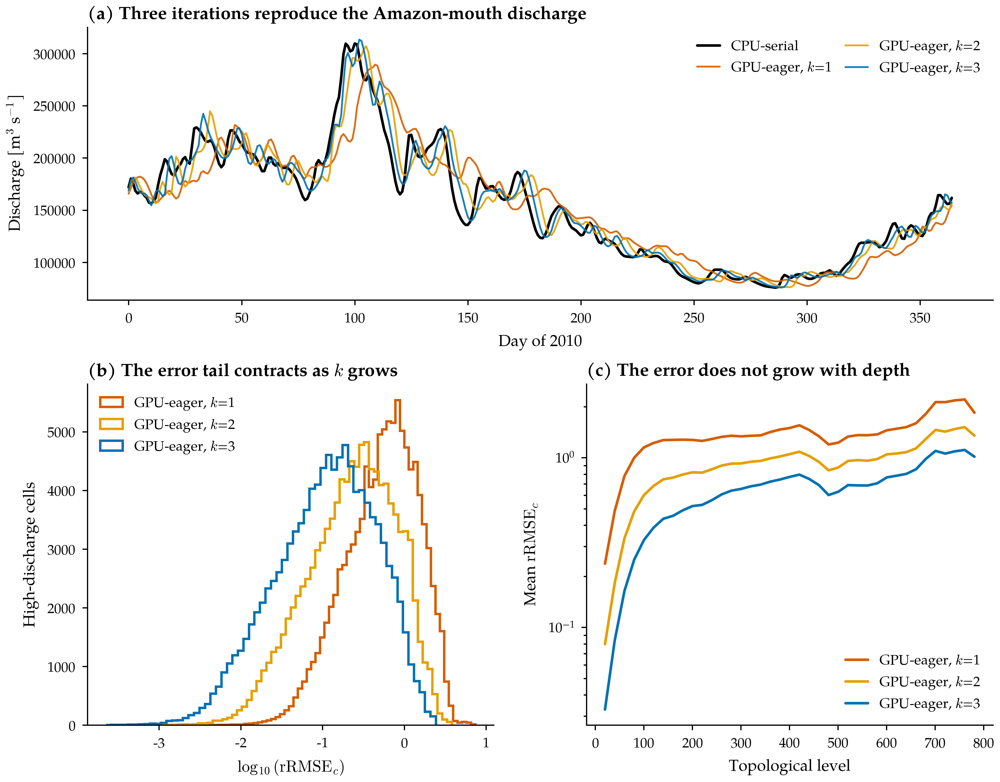
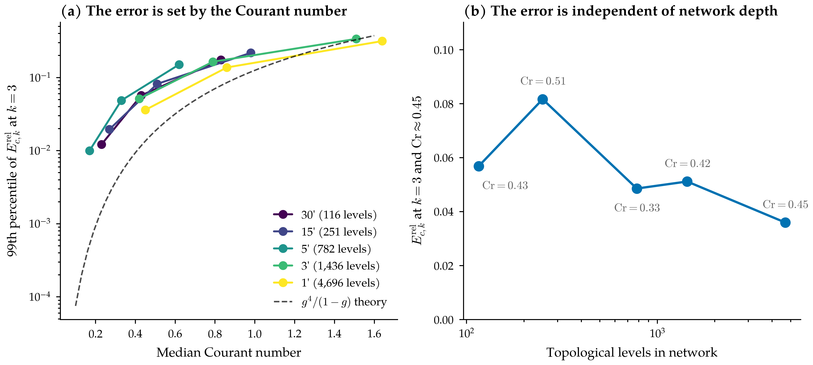
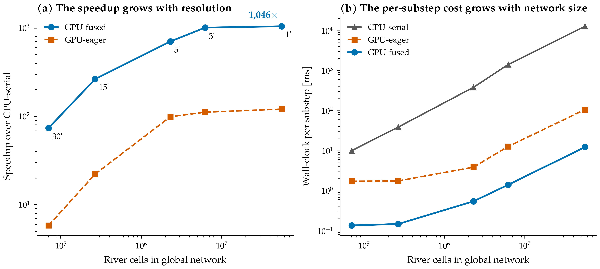
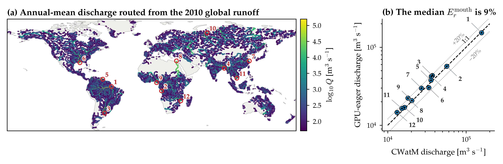

# Paper figures

Reproducible figures for the manuscript *"Parallelizing kinematic-wave river
routing on the GPU via a convergent fixed-point reformulation"* (submitted to
*JAMES*). Each figure is regenerated by one script reading only the compact
data committed here — no raw model output or GPU is needed to redraw them.

```
paper/
├── figure_scripts/   one script per figure + shared style (paper_style.py)
├── figure_data/      compact plotting data (a few MB, distilled from ~90 MB of raw arrays)
└── figures/          the PNGs used in the manuscript
```

## Figure ↔ script ↔ data

| Manuscript | Script | Reads | Produces |
|---|---|---|---|
| Fig. 1 (method schematic) | `fig_method.py` | *(none — pure schematic)* | `fig_method.png` |
| Fig. 2 (Courant damping law) | `fig_accuracy.py` | `accuracy.json`, `accuracy_bigcells.npz` | `fig_courant_theory.png` |
| Fig. 3 (Jacobi validation) | `fig_accuracy.py` | `accuracy.json`, `accuracy_bigcells.npz` | `poc_jacobi_validation.png` |
| Fig. 4 (depth independence) | `fig_depth.py` | *(measured values inline)* | `fig_depth_independence.png` |
| Fig. 5 (resolution scaling) | `fig_scaling.py` | *(measured values inline)* | `fig_resolution_scaling.png` |
| Fig. 6 (scheme throughput) | `fig_scheme_throughput.py` | `scheme_bench.json` | `fig_scheme_throughput.png` |
| Fig. 7 (GRanD reservoirs) | `fig_reservoir.py` | `scheme_bench.json` | `fig_reservoir.png` |
| Fig. 8 (global validation) | `fig_globalmap.py` | `global_map.npz`, `rivermouths.json` | `fig_global_validation.png` |

`fig_accuracy.py` writes both Fig. 2 and Fig. 3 (they share one data load).
Figs. 6 and 7 (wavefront vs Jacobi throughput; the three schemes with the full
GRanD dam set) come from `bench_wavefront.py` and `bench_reservoir.py` run on an
A100; their measured numbers are collected in `figure_data/scheme_bench.json`.

## Figures

**Fig. 1 — Method schematic.** The same drainage network solved three ways:
serial (CPU), exact wavefront (GPU), and the Jacobi fixed point (GPU).



**Fig. 2 — Courant damping law.** Per-cell error collapses onto the theoretical
contraction `g^{k+1}/(1-g)` and falls with sweep count `k`.



**Fig. 3 — Jacobi validation.** Hydrograph, error distribution, and error vs
topological depth against the serial-C oracle on the 5-arcmin global network.



**Fig. 4 — Depth independence.** A fixed sweep count holds from 30′ to 1′
(116 → 4,696 topological levels); accuracy is set by the Courant number, not depth.



**Fig. 5 — Resolution scaling.** Measured single-run speedup vs network size
(A100, eager and torch.compile-fused), up to 1,046× at 1-arcmin (56M cells).



**Fig. 6 — Global validation.** Routed annual-mean discharge with 12 validation
river mouths (left) and routed vs CWatM discharge at those mouths (right).



## Data provenance

| File | Content |
|---|---|
| `accuracy.json` | hydrograph, per-sweep RMSE/NSE, theory-collapse samples (serial-C oracle vs Jacobi, 5-arcmin global net) |
| `accuracy_bigcells.npz` | per-cell relative RMSE (k=1,2,3) and topological level, big-river cells only |
| `global_map.npz` | annual-mean routed discharge for cells > 50 m³ s⁻¹, subsampled 1-in-3 (`lon`, `lat`, `log10 Q`) |
| `rivermouths.json` | the 12 validation river mouths — routed vs CWatM discharge and coordinates |

The measured speedup/timing/drift numbers behind Figs. 4–5 (and the manuscript
tables) are the raw benchmark outputs; the values are embedded directly in the
scripts so they are self-documenting.

## Reproduce

```bash
cd paper/figure_scripts
python fig_method.py        # Fig. 1
python fig_accuracy.py      # Figs. 2 & 3
python fig_depth.py         # Fig. 4
python fig_scaling.py       # Fig. 5
python fig_globalmap.py     # Fig. 6 — needs cartopy
```

All but `fig_globalmap.py` need only `numpy` + `matplotlib`. Fig. 6 additionally
needs `cartopy` (coastlines/land). Figures use the shared house style in
`paper_style.py` (falls back to matplotlib defaults if the optional
*Myriad Pro* font is absent); math labels use the Computer Modern set to match
the LaTeX-compiled body text. Paths are resolved relative to the script, so the
commands work from anywhere.
